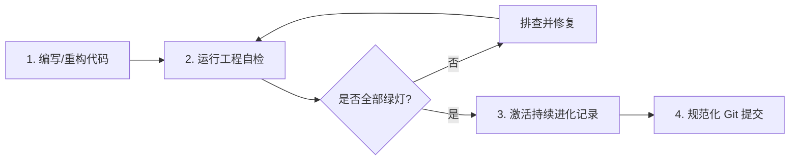

# MiyoQian 专业化开发与持续演进指南 (MiyoQian Engineer Skill)

本 Skill 是 MiyoQian 项目的核心工程准则与自动化操作手册。AI Agent 在进行任何代码修改、重构设计、配置变更或环境部署时，必须遵循本文档及其关联规范。

--------------------------------------------------------------------------------

## 1. 核心架构与工程原则 (Core Principles)

在修改或扩展本代码库时，必须严格遵守以下四大工程原则：

1. **高内聚低耦合与仓储模式 (Repository Pattern)**：
   - 账户凭证持久化操作**只能**通过 [`AccountRepository`](file:///miyouqian/core/accounts.py) 进行，严禁直接在业务层读写 JSON/YAML 文件。
   - 所有写入必须满足**原子替换机制**（临时文件 + `os.fsync()` + `replace()`），确保宿主机断电或容器重启数据不损坏。
   - 详见：[账户存储与迁移规范](./references/storage_spec.md) 及 [核心架构设计指南](./references/architecture.md)。

2. **缓存与构建零污染原则 (Zero-Pollution Hygiene)**：
   - 源码目录（`miyouqian/`、`tests/`）严禁产生任何 `__pycache__` 或 `.pyc` 文件。
   - 所有字节码缓存自动重定向至最外层 `.cache/pycache`（依托 [`sitecustomize.py`](file:///sitecustomize.py)）。
   - 打包构建产物统一归集至最外层 `dist/`。
   - 详见：[缓存隔离与卫生规范](./references/cache_hygiene.md)。

3. **故障隔离与幂等性原则 (Fault Isolation & Idempotency)**：
   - 账号间、阶段间（游戏签到/米游币/云游戏）、子项目间必须实施逐级异常捕获，单点故障不得中断整个批次。
   - 仅对幂等的 GET 请求进行网络超时重试；POST 请求与单次有效的 Geetest 验证码挑战**绝不原样重试**。

4. **系统轻量化与专注度 (Minimal Footprint)**：
   - 专注于核心签到与日常调度，避免引入庞杂的第三方即时通信推送系统。
   - 优先使用项目已有的现代依赖（`httpx`、`loguru`、`dataclasses`），坚决避免自造轮子。

--------------------------------------------------------------------------------

## 2. 标准开发与验证工作流 (Standard Workflow)

在完成任何代码修改后，必须依次执行以下标准化流程：



### 步骤 1：执行工程质量与规范自检
在代码变更后，直接运行内置的自检脚本：
```bash
python .agents/skills/miyoqian-engineer/scripts/verify_project.py
```
> [!IMPORTANT]
> 门禁检查包含四项指标：单元测试 100% 通过、源码目录无 `.pyc` 污染、账户存储接口正常、配置文件完整。有一项不通过均不可提交。

### 步骤 2：运行单元测试
如需单独调试单元测试，执行：
```bash
python -m unittest discover tests
```

### 步骤 3：常规提交规范 (Conventional Commits)
Git 提交信息必须遵循语义化提交规范，格式为 `<type>(<scope>): <subject>`：
- `feat`: 新增业务功能或支持新游戏
- `fix`: 修复逻辑缺陷或网络重试问题
- `refactor`: 重构架构、清理冗余依赖
- `perf`: 性能优化、构建加速或内存瘦身
- `chore`: 配置微调或文档演进

--------------------------------------------------------------------------------

## 3. 持续进化机制 (Continuous Evolution SOP)

本 Skill 具备自适应进化的活体特性。当满足以下条件时，必须执行持续进化流程：
- 解决了前所未有的疑难 Bug（如验证码频控、米游社新风控特征）；
- 重构了关键架构设计或扩展了 `account.json` 模式；
- 用户提出了具有指导意义的工程约束或代码偏好。

### 进化操作指引：
1. **提取经验与反模式**：提炼关键决策点与避坑准则。
2. **运行进化助手**：
   使用内置助手将演进记录结构化写入演进账本：
   ```bash
   python .agents/skills/miyoqian-engineer/scripts/evolve_skill.py \
     --category [arch|storage|cache|perf|fix|rule] \
     --title "演进简述" \
     --details "详细决策依据、实现要点及防踩坑说明"
   ```
3. **查阅演进账本**：
   所有历史演进决策可随时在 [持续演进账本 (Evolution Ledger)](./references/evolution_log.md) 中查阅与审计。
4. **渐进式沉淀**：
   若该经验具有长期的全局指导意义，将相应要点提炼并补充进 `./references/` 对应文档或本文档的核心原则中。

--------------------------------------------------------------------------------

## 4. 辅助工具与参考清单 (References & Tools)

- 🛠️ **健康自检脚本**: [`scripts/verify_project.py`](./scripts/verify_project.py)
- 🚀 **演进记录助手**: [`scripts/evolve_skill.py`](./scripts/evolve_skill.py)
- 📖 **核心架构设计指南**: [`references/architecture.md`](./references/architecture.md)
- 💾 **账户存储与自动迁移规范**: [`references/storage_spec.md`](./references/storage_spec.md)
- 🧹 **缓存隔离与零污染规范**: [`references/cache_hygiene.md`](./references/cache_hygiene.md)
- 🔄 **持续进化工作指南**: [`references/evolution_guide.md`](./references/evolution_guide.md)
- 📜 **持续演进历史账本**: [`references/evolution_log.md`](./references/evolution_log.md)
