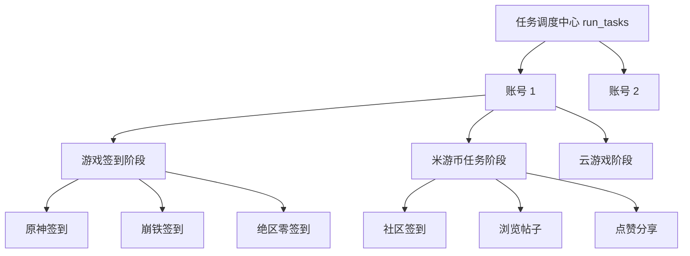

# MiyoQian 核心架构设计与工程规范指南

本文档作为 `miyoqian-engineer` Skill 的核心参考资料，定义 MiyoQian 项目的软件工程架构规范、设计模式准则与健壮性准则。

--------------------------------------------------------------------------------

## 1. 软件工程与设计模式准则

### 1.1 仓储模式 (Repository Pattern)
- **定位**：账户与凭证持久化操作统一收敛于 `miyouqian.core.accounts.AccountRepository`。
- **职责**：
  - 上层业务（Tasks、WebUI、Runner）只与领域对象 `Account` 交互，禁止直接操作底层存储文件（如手写 `json.dump` / `yaml.safe_load`）。
  - 仓储层负责屏蔽文件路径差异、格式迁移（从 legacy `config.yaml` / `credentials.yaml` 迁移至 `account.json`）与安全写入。
- **持久化安全性**：
  - 必须采用**原子替换机制**（先写同目录临时文件 -> `flush()` -> `os.fsync()` -> 尝试赋权 `0o600` -> `replace()`）。
  - 防止操作系统断电、进程异常中断导致的 JSON 文件损毁或空文件故障。

### 1.2 高内聚低耦合与“不重复造轮子”
- **核心定位收敛**：本项目专注于米游社自动化签到与任务日常，坚决移除与核心无关的大而全模块（如各类第三方推送机器人、繁杂的即时通信协议通道）。
- **标准库与成熟依赖优先**：
  - 异步/同步 HTTP 统一使用 `httpx`；
  - 结构化日志统一使用 `loguru`；
  - 数据模型推荐使用标准库 `dataclasses`，保持轻量高效。

--------------------------------------------------------------------------------

## 2. 异常处理与故障隔离架构 (Fault Isolation)

在多账号、多游戏、多子任务的调度体系中，必须贯彻**逐级故障隔离原则**：

### 2.1 隔离边界层级
1. **账号级隔离**：账号 A 的登录失效或请求异常，绝不能中断账号 B 的执行。
2. **阶段级隔离**：游戏签到阶段异常，米游币和云游戏阶段仍须照常执行。
3. **条目级隔离**：
   - 某游戏单个角色异常，不影响该游戏其他角色；
   - 单个游戏失败，不影响其他游戏签到；
   - 米游币单个看帖或点赞子操作失败，不影响其余任务点数获取。
4. **统一收拢**：所有捕获的条目失败只记录至该账号的失败项列表，并向最终结果输出明确的警告，绝不向上抛出未捕获的严重异常中断流程。

--------------------------------------------------------------------------------

## 3. 网络请求与幂等重试原则 (HTTP & Idempotency)

- **GET 请求**：
  - 属于只读、幂等操作；
  - 仅针对建立连接后的读取超时（`ReadTimeout`、`ReadError`、`RemoteProtocolError`）进行有限重试（如退避 1.5s、3s，最多 2 次）。
- **POST 请求**：
  - 包含状态变更或业务提交；
  - 发生读取超时时，服务端可能已经完成扣费、签到或抽奖，**坚决不自动重发请求**，防止重复提交。
- **验证码与打码服务**：
  - 极验 (Geetest) 等验证码 challenge 具有单次有效性，一旦使用即失效；
  - 业务接口遇验或打码接口报错时，**严禁使用同一个 challenge 原样重复重试**（避免浪费配额、消耗重复计费或被服务端秒拒）；
  - 仅在遇到打码平台自身 429/503 排队限流时方可退避重试，其余业务错误必须重新发起外层验证码获取流程。

--------------------------------------------------------------------------------

## 4. 容器化与轻量化构建标准 (Docker)

1. **多阶段构建 (Multi-stage)**：
   - `builder` 阶段负责依赖下载与编译；
   - `runner` 阶段只复制运行时所需文件与安装好的虚拟环境，彻底剥离构建工具与编译缓存。
2. **镜像源加速**：
   - 针对国内环境，支持动态参数构建国内 PyPI 源（如 Tsinghua / Aliyun）；
   - Docker Hub 镜像直接使用官方库或成熟加速器，禁止使用失效或强制在线拉取的 `# syntax=` 指令。
3. **上下文极简**：
   - `.dockerignore` 必须排除虚拟环境 `.venv/`、缓存 `.cache/`、编译输出 `dist/`、文档与 git 历史。
