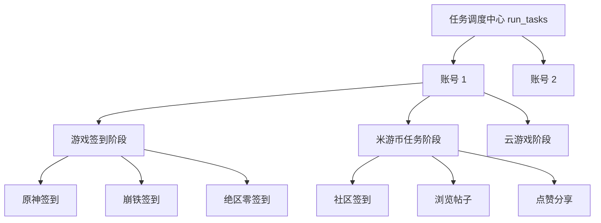

# MiyoQian 核心架构设计与工程规范指南

本文档作为 `miyoqian-engineer` Skill 的核心参考资料，定义 MiyoQian 项目的软件工程架构规范、设计模式准则与健壮性准则。

--------------------------------------------------------------------------------

## 1. 软件工程与设计模式准则

### 1.1 仓储模式 (Repository Pattern)
- **定位**：账户与凭证持久化操作统一收敛于 `miyouqian.core.accounts.AccountRepository`。
- **职责**：
  - 上层业务（Tasks、WebUI、Runner）只与领域对象 `Account` 交互，禁止直接操作底层存储文件（如手写 `json.dump` / `yaml.safe_load`）。
  - 仓储层负责屏蔽文件路径差异、格式迁移（从 legacy `config.yaml` / `credentials.yaml` 迁移至 `account.json`）与安全写入。
- **持久化安全性**：
  - 必须采用**原子替换机制**（先写同目录临时文件 -> `flush()` -> `os.fsync()` -> 尝试赋权 `0o600` -> `replace()`）。
  - 防止操作系统断电、进程异常中断导致的 JSON 文件损毁或空文件故障。

### 1.2 高内聚低耦合与“不重复造轮子”
- **核心定位收敛**：本项目专注于米游社自动化签到与任务日常，坚决移除与核心无关的大而全模块（如各类第三方推送机器人、繁杂的即时通信协议通道）。
- **标准库与成熟依赖优先**：
  - 异步/同步 HTTP 统一使用 `httpx`；
  - 结构化日志统一使用 `loguru`；
  - 数据模型推荐使用标准库 `dataclasses`，保持轻量高效。

--------------------------------------------------------------------------------

## 2. 异常处理与故障隔离架构 (Fault Isolation)

在多账号、多游戏、多子任务的调度体系中，必须贯彻**逐级故障隔离原则**：

### 2.1 隔离边界层级
1. **账号级隔离**：账号 A 的登录失效或请求异常，绝不能中断账号 B 的执行。
2. **阶段级隔离**：游戏签到阶段异常，米游币和云游戏阶段仍须照常执行。
3. **条目级隔离**：
   - 某游戏单个角色异常，不影响该游戏其他角色；
   - 单个游戏失败，不影响其他游戏签到；
   - 米游币单个看帖或点赞子操作失败，不影响其余任务点数获取。
4. **统一收拢**：所有捕获的条目失败只记录至该账号的失败项列表，并向最终结果输出明确的警告，绝不向上抛出未捕获的严重异常中断流程。

--------------------------------------------------------------------------------

## 3. 网络请求与幂等重试原则 (HTTP & Idempotency)

- **GET 请求**：
  - 属于只读、幂等操作；
  - 仅针对建立连接后的读取超时（`ReadTimeout`、`ReadError`、`RemoteProtocolError`）进行有限重试（如退避 1.5s、3s，最多 2 次）。
- **POST 请求**：
  - 包含状态变更或业务提交；
  - 发生读取超时时，服务端可能已经完成扣费、签到或抽奖，**坚决不自动重发请求**，防止重复提交。
- **验证码与打码服务**：
  - 极验 (Geetest) 等验证码 challenge 具有单次有效性，一旦使用即失效；
  - 业务接口遇验或打码接口报错时，**严禁使用同一个 challenge 原样重复重试**（避免浪费配额、消耗重复计费或被服务端秒拒）；
  - 仅在遇到打码平台自身 429/503 排队限流时方可退避重试，其余业务错误必须重新发起外层验证码获取流程。

--------------------------------------------------------------------------------

## 4. 容器化与轻量化构建标准 (Docker)

1. **多阶段构建 (Multi-stage)**：
   - `builder` 阶段负责依赖下载与编译；
   - `runner` 阶段只复制运行时所需文件与安装好的虚拟环境，彻底剥离构建工具与编译缓存。
2. **镜像源加速**：
   - 针对国内环境，支持动态参数构建国内 PyPI 源（如 Tsinghua / Aliyun）；
   - Docker Hub 镜像直接使用官方库或成熟加速器，禁止使用失效或强制在线拉取的 `# syntax=` 指令。
3. **上下文极简**：
   - `.dockerignore` 必须排除虚拟环境 `.venv/`、缓存 `.cache/`、编译输出 `dist/`、文档与 git 历史。

--------------------------------------------------------------------------------

## 5. 配置热更、状态同步与调度生命周期模型 (Config & Scheduler Lifecycle)

### 5.1 全量静态分析模型准则
- 严禁盲目依赖 git 翻查历史。对于百行至万行规模的项目，必须建立端到端完整的状态流模型：
  `UI 交互 -> DOM 采集 -> HTTP Payload -> 后端合并与持久化 -> 调度器 Reload -> 线程主循环 -> 任务编排`。

### 5.2 前端状态持久化安全准则
- **内存底本优先**：DOM 节点随时可能因 Tab 切换、分页、折叠或异步加载而未挂载在页面中。前端配置收集函数（如 `collectShopExchange`、`collectAccounts`）必须以当前内存中的已有配置对象为底本（`{ ...existingItem }`），仅将当前实际处于挂载状态且被修改的 DOM 字段覆盖上去，绝不可直接通过 `querySelectorAll` 结果重置或清空原对象。
- **空列表误杀防护**：当 DOM 查询结果为空列表而内存中仍有数据时，必须坚守已有数据，禁止静默向后端提交空数组，防止无意识抹除磁盘数据。

### 5.3 后端防御性合并与凭证保护准则
- **凭据不可逆抹除**：`WebApp.set_config` 在接收客户端提交的配置变更时，必须比对现有配置并执行凭证（`cookie`、`stoken`、`mid`、`tokens`）深度合并。任何前端非全量或脱敏数据提交均不得导致磁盘凭据被冲刷清空。
- **业务计划保护**：针对兑换计划、任务计划等包含复杂状态与时间的集合，必须支持显式清空与隐式缺省的区分。

### 5.4 调度器事件循环与唤醒契约
- **唤醒与到期解耦**：调度器使用 `threading.Event` 监听配置重载或外部中断信号时，若到达或已超过预定执行时间，唤醒信号不得吞噬本次任务的执行机会。
- **过期任务补执行语义**：严禁采用粗暴的“逾期超过 X 分钟即跳至次日”的丢弃逻辑。调度器必须结合当日本任务的实际执行状态（`last_run.date() == today`）来裁决是否属于未完成任务。
- **随机延后 (Jitter) 的重排一致性**：在延后等待期间检测到签名变更中断延后时，调度器需保持重排状态一致，不得因签名变更误将当日待执行任务丢弃至次日。

--------------------------------------------------------------------------------

## 6. 模块化治理与巨型代码防劣化准则 (Anti-Monolith & High-Cohesion)

### 6.1 单文件体量红线
- 任何源文件（无论 Python 还是 JavaScript）单文件体量原则上应**严格控制在 500-800 行以内**，坚决禁止超过 1000 行的“上帝类”或“全功能单体巨石文件”。
- 一旦某模块开始聚集跨领域关注点（如网络通信、UI渲染、业务计算、加解密、校验），必须立即按单一职责原则进行分解。

### 6.2 后端服务治理：Mixin 混入与协调器模式
- **核心聚合协调器**：`WebApp` 仅保留服务生命周期（启动/停止）、状态度量、全局日志及核心配置协调，体量保持在 200 行以内。
- **业务领域 Mixin 混入**：
  - 登录流程解耦为 `WebLoginMixin` (`web_login.py`)；
  - 商品兑换流程解耦为 `WebShopMixin` (`web_shop.py`)；
  - 差异对比与凭证合并解耦为 `web_diff.py`；
  - HTTP 路由、静态文件服务与服务器启动解耦为 `web_server.py`。
- **向后兼容契约**：所有解耦出的公共接口必须在包入口（`web.py`）显式重导出，确保外部 CLI、自动化脚本及测试用例零成本迁移。

### 6.3 前端工程治理：领域子模块与轻量自动打包机制
- **领域子模块正交化**：前端代码严格按功能边界划分至 `miyouqian/webui/src/`：
  - `constants.js`：全局字典、枚举配置与全生命周期响应式状态；
  - `utils.js`：网络抽象、Toast 提示、时间与文本编解码、日志视图；
  - `config_view.js`：全局签到、分区、打码与验证码规范文档管理；
  - `accounts_view.js`：账号卡片、Token 采集、账号列表状态合并；
  - `shop_view.js`：商品网格、分页控制、计划抽屉与角色级联；
  - `login_view.js`：扫码与短信验证、倒计时、极验二次校验；
  - `records_view.js`：执行历史卡片、耗时与阶段明细折叠展示；
  - `main.js`：主轮询定时器、仪表盘指标联动、Tab 路由切换与初始化入口。
- **零依赖极简自动构建**：
  - 避免引入庞大的外部打包依赖链（Webpack、Vite、Node 工具链）；
  - 采用 Python 轻量打包器 `bundle.py`，并在 `web_server.py` 启动或静态文件请求时自动根据模块 mtime 增量拼装生成分发文件 `app.js`；
  - 分发文件严格保持全局作用域与结尾 `startApp();` 契约，保证浏览器直接运行与 Node.js 虚拟环境测试 100% 兼容。
