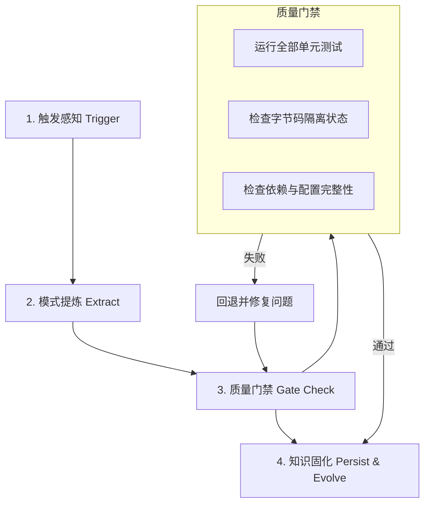

# MiyoQian 技能持续进化机制规范 (Continuous Evolution Guide)

本项目将 AI Skill 视为一个**具备自适应更新能力的活体工程资产**，而非一成不变的静态模板。
当项目经历架构调整、新增业务模式、排查疑难缺陷或收到用户关键纠偏时，AI Agent 必须主动激活持续进化机制。

--------------------------------------------------------------------------------

## 1. 持续进化的四大触发场景 (Triggers)

| 场景类型 | 触发标识 | 示例 | 进化动作 |
| :--- | :--- | :--- | :--- |
| **架构演进** | `ARCH_CHANGE` | 引入新模块、重构核心流程、剔除陈旧子系统 | 沉淀新架构边界与依赖规则 |
| **持久化变更** | `STORAGE_EVOLVE` | 调整 `account.json` 模式、扩展字段、变更迁移契约 | 更新存储规范与字段校验矩阵 |
| **避坑与缺陷修复**| `BUG_FIX` | 发现特定网络重试死锁、Geetest 挑战复用失效 | 提炼防御性编程规则与反模式清单 |
| **用户指令与偏好**| `USER_PREFERENCE` | 用户提出“避免重复造轮子”、“不污染源码目录”等要求 | 固化为项目级工程铁律 |

--------------------------------------------------------------------------------

## 2. 闭环演进标准工作流 (4-Step Closed Loop)



### 步骤详解：

### 第一步：触发感知 (Trigger Detection)
每当任务涉及重大重构、模块剥离、新功能加入或用户纠偏时，Agent 需明确识别该变更是否具备全局指导意义。

### 第二步：模式提炼 (Pattern Extraction)
提取核心规律与约束：
- 解决了什么问题？为什么这样设计更优？
- 有哪些“绝对不要做”的反模式 (Anti-patterns)？
- 涉及哪些文件或设计模式变更？

### 第三步：质量门禁自检 (Quality Gate Verification)
在记录进化之前，必须运行自检脚本确保项目处于绝对健康状态：
```bash
python .agents/skills/miyoqian-engineer/scripts/verify_project.py
```
- **红线**：若测试未全部通过，或存在缓存污染，绝不允许持久化进化记录。

### 第四步：知识固化与技能更新 (Knowledge Persistence)
使用演进助手脚本自动追加记录：
```bash
python .agents/skills/miyoqian-engineer/scripts/evolve_skill.py \
  --category [arch|storage|cache|perf|fix|rule] \
  --title "一句话演进摘要" \
  --details "详细设计考量、操作规范与防坑要点"
```
若演进内容对日常开发有根本性指导意义，Agent 还应适度更新 `SKILL.md` 的核心准则章节。

--------------------------------------------------------------------------------

## 3. 经验提炼与反模式清单 (Anti-Patterns Reference)

持续进化不仅要记录“怎么做”，更要沉淀“不可怎么做”：
- ❌ **反模式 1**：在签到任务中随意捕获所有异常并静默忽略，导致无法排查失败原因；
- ❌ **反模式 2**：对验证码打码接口采用与普通 GET 接口相同的盲目重试逻辑；
- ❌ **反模式 3**：在源码内部直接生成编译产物或临时测试文件；
- ❌ **反模式 4**：将敏感账户凭据与应用级常规配置混在一个大 YAML 文件中并硬编码写入。
