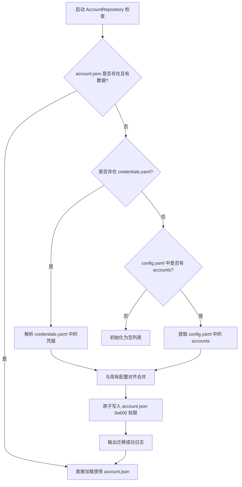

# MiyoQian 账户存储与自动迁移规范 (Storage & Migration Spec)

本文档定义 `account.json` 数据结构、Docker 映射契约以及平滑升级的自动迁移算法。

--------------------------------------------------------------------------------

## 1. 存储设计目标

- **解耦配置与私密数据**：将运行系统配置（`config.yaml`）与易变的用户账号/凭据（`account.json`）完全分离。
- **容器与宿主机友好**：支持独立映射单个 `account.json` 或 `data/` 目录，无需暴露敏感配置文件。
- **数据写入高可靠**：全流程采用原子写（Atomic Write）与操作审计，规避并发写坏风险。

--------------------------------------------------------------------------------

## 2. 数据结构规范 (`account.json`)

`account.json` 根级支持标准列表格式或带版本标识的对象格式：

```json
[
  {
    "cookie": "ltoken_v2=...; ltuid_v2=...;",
    "stuid": "10000001",
    "stoken": "v2_...",
    "mid": "0123456789_...",
    "device_id": "",
    "device_fp": "",
    "games": {
      "enabled": ["genshin", "starrail", "zzz"]
    },
    "cloud_games": {
      "genshin": "cg_token_...",
      "zzz": "cg_token_..."
    }
  }
]
```

### 字段说明与约束
| 字段名 | 类型 | 说明 | 必填性 |
| :--- | :--- | :--- | :--- |
| `cookie` | string | 米游社网页/App Cookie 串 | 是 |
| `stuid` | string | 米游社通行证数字 UID | 是 |
| `stoken` | string | 核心接口凭据 stoken (推荐 v2) | 是 |
| `mid` | string | 米哈游账号 mid 凭据 | 推荐 |
| `device_id` / `device_fp` | string | 自定义绑定的设备标识（可选，留空则使用全局预设） | 否 |
| `games.enabled` | array[str] | 启用的签到游戏列表（如 genshin, starrail, zzz, honkai3） | 否 |
| `cloud_games` | object | 云游戏对应游戏 Key 与专属 Token 映射 | 否 |

--------------------------------------------------------------------------------

## 3. Docker 卷映射契约

在容器化部署中，推荐通过挂载独立卷持久化 `account.json`：

```yaml
services:
  miyouqian:
    image: miyouqian:latest
    volumes:
      # 方式一：挂载整个数据目录（推荐）
      - ./data:/app/data
      # 方式二：直接映射单个账号文件
      - ./account.json:/app/data/account.json
      # 运行时日志输出
      - ./logs:/app/logs
```

在启动时，`docker/entrypoint.sh` 或服务初始化代码应确保：
1. 目标挂载点所在目录已创建；
2. 如果宿主机未提供文件，自动生成初始空文件或从已有配置执行迁移。

--------------------------------------------------------------------------------

## 4. 自动迁移算法 (Auto-Migration Flow)

当系统初始化调用 `AccountRepository.migrate_if_needed()` 时，按以下顺序执行平滑迁移：



### 迁移防丢保障
- 自动迁移不会直接物理删除旧的 `credentials.yaml` 或 `config.yaml` 中的账号节点，保留作为故障回退保障；
- 迁移只在 `account.json` 不存在或为空时自动触发一次，避免覆盖用户后续对 `account.json` 的修改。
